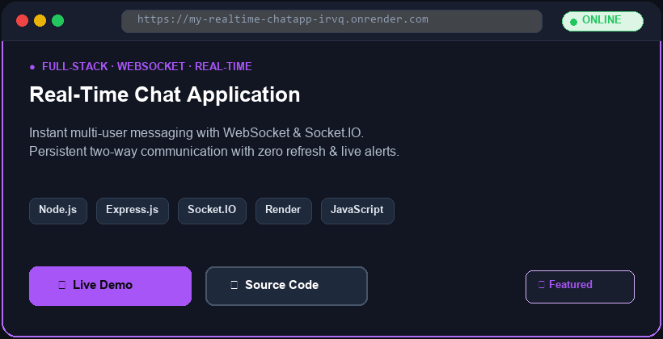
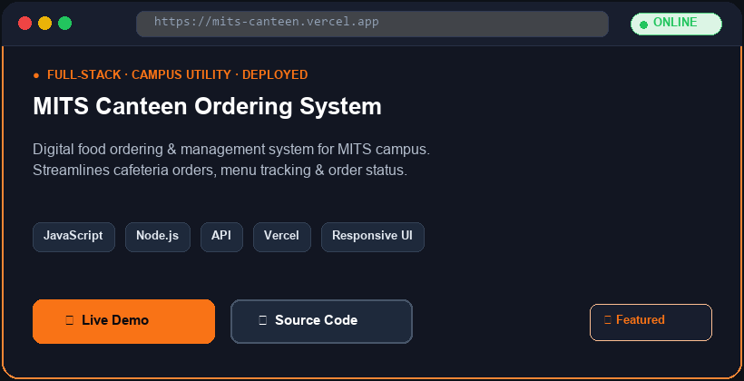
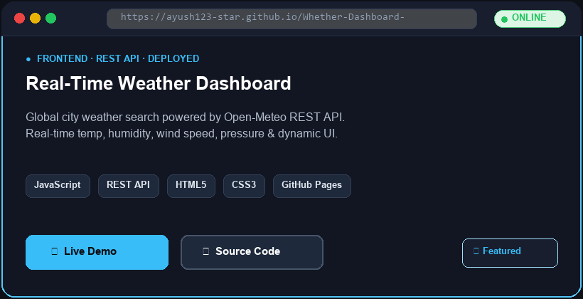
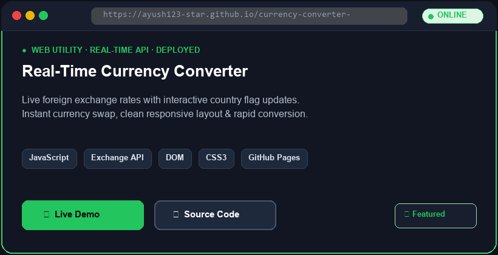
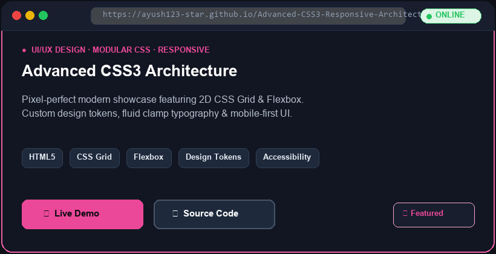
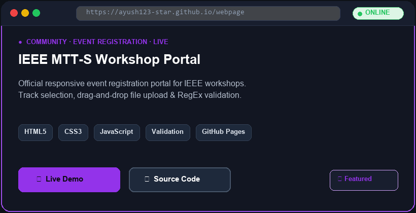

<div align="center">

  <!-- ======================== BANNER ======================== -->
  

  <br/><br/>

  <!-- ======================== ANIMATED TYPING HEADER ======================== -->
  <a href="https://git.io/typing-svg">
    
  </a>

  <!-- ======================== PROFILE VIEWS & STATS BADGES ======================== -->
  <p align="center">
    
    
    
  </p>

  

  <!-- ======================== INTERACTIVE QUICK CONNECT CARDS ======================== -->
  <h2>⚡ Quick Connect & Profiles</h2>
  <p><i>Click any card below to directly open my live profiles & portfolio:</i></p>

  <table align="center" border="0" cellpadding="6" cellspacing="6">
    <tr>
      <td align="center">
        <a href="https://portfolio-jade-two-92.vercel.app/" target="_blank">
          
        </a>
      </td>
      <td align="center">
        <a href="https://www.linkedin.com/in/ayush-pandey-a9161b275" target="_blank">
          
        </a>
      </td>
      <td align="center">
        <a href="https://leetcode.com/u/mf6KatW2Tw" target="_blank">
          
        </a>
      </td>
      <td align="center">
        <a href="https://github.com/ayush123-star" target="_blank">
          
        </a>
      </td>
      <td align="center">
        <a href="mailto:pandeyayush1603@gmail.com">
          
        </a>
      </td>
    </tr>
  </table>

  <br/>

  <!-- Direct Badge Pills -->
  <p align="center">
    <a href="https://portfolio-jade-two-92.vercel.app/" target="_blank">
      
    </a>
    <a href="https://www.linkedin.com/in/ayush-pandey-a9161b275" target="_blank">
      
    </a>
    <a href="https://leetcode.com/u/mf6KatW2Tw" target="_blank">
      
    </a>
    <a href="https://github.com/ayush123-star" target="_blank">
      
    </a>
    <a href="mailto:pandeyayush1603@gmail.com">
      
    </a>
    <a href="https://www.instagram.com/ayush_pandey_0816/" target="_blank">
      
    </a>
  </p>

</div>

<br/>

<!-- ======================== ABOUT ME ======================== -->
## 👨‍💻 About Me

```yaml
Name: Ayush Pandey
Location: Gwalior, Madhya Pradesh, India 📍
Degree: B.Tech in Electronics & Telecommunication (2025–2029) 🎓
Institution: Madhav Institute of Technology and Science (MITS), Gwalior
Focus: Full-Stack Web Development, Real-Time Systems, DSA & Hardware Integration
Current Role: Technical Team Member @ IEEE MTT-S Student Branch Chapter
Past Role: Web Development Intern @ Thiranex
Passions: Web Architecture, Problem Solving, Guitar 🎸, Photography 📸, Japanese 🏯
```

- 🚀 **Full-Stack Developer** passionate about architecting scalable web applications, real-time communication systems, and bridging the gap between software and hardware.
- 🎓 Combining strong analytical problem-solving skills with hands-on full-stack development.
- 💡 Experienced with **Node.js, Express, Socket.IO, JavaScript, REST APIs, MongoDB, SQL** and modern responsive UI/UX architecture.
- 🎯 Constantly grinding Data Structures & Algorithms on **LeetCode** and participating in competitive programming contests.
- 💬 Ask me about **WebSockets, Full-Stack Architecture, JavaScript Internals, and Frontend Design Systems**.
- 📫 Reach me directly at: **[pandeyayush1603@gmail.com](mailto:pandeyayush1603@gmail.com)** or **[+91 90395 67623](tel:+919039567623)**.

<br/>

<!-- ======================== TECH STACK & SKILLS ======================== -->
## 🛠️ Tech Stack & Skills

<div align="center">
  
</div>

<br/>

### 💻 Categories & Tooling

| Category | Technologies & Tools |
| :--- | :--- |
| **Frontend Development** |      |
| **Backend & Real-Time** |     |
| **Languages & DSA** |      |
| **Databases & Storage** |   |
| **DevOps & Hosting** |      |
| **Software & Analytics** |     |

<br/>


<!-- ======================== FEATURED PROJECTS SHOWCASE WITH PHOTOS ======================== -->
## 🚀 Featured Projects Showcase

*Every project uploaded on GitHub presented with interactive previews, tech stacks, live demos and repository links:*

<table align="center" width="100%" border="0" cellpadding="8">
  <!-- ROW 1 -->
  <tr>
    <td width="50%" align="center" valign="top">
      <a href="https://my-realtime-chatapp-irvq.onrender.com" target="_blank">
        
      </a>
      <br/>
      <b>💬 Real-Time Chat Application</b>
      <p>Instant bidirectional chat app with live user join notifications & zero page reloads.</p>
      <a href="https://my-realtime-chatapp-irvq.onrender.com" target="_blank">
        
      </a>
      <a href="https://github.com/ayush123-star/my-realtime-chatapp" target="_blank">
        
      </a>
    </td>
    <td width="50%" align="center" valign="top">
      <a href="https://mits-canteen.vercel.app" target="_blank">
        
      </a>
      <br/>
      <b>🍔 MITS Canteen Management</b>
      <p>Digital ordering and cafeteria workflow system built specifically for MITS campus.</p>
      <a href="https://mits-canteen.vercel.app" target="_blank">
        
      </a>
      <a href="https://github.com/ayush123-star/Mits-Canteen" target="_blank">
        
      </a>
    </td>
  </tr>

  <!-- ROW 2 -->
  <tr>
    <td width="50%" align="center" valign="top">
      <a href="https://ayush123-star.github.io/Whether-Dashboard-/" target="_blank">
        
      </a>
      <br/>
      <b>🌦️ Real-Time Weather Dashboard</b>
      <p>Global weather tracker querying Open-Meteo REST API for live temperature, wind & pressure.</p>
      <a href="https://ayush123-star.github.io/Whether-Dashboard-/" target="_blank">
        
      </a>
      <a href="https://github.com/ayush123-star/Whether-Dashboard-" target="_blank">
        
      </a>
    </td>
    <td width="50%" align="center" valign="top">
      <a href="https://ayush123-star.github.io/currency-converter-/" target="_blank">
        
      </a>
      <br/>
      <b>💱 Real-Time Currency Converter</b>
      <p>Live exchange rate converter with automatic country flag changes & quick swap mechanics.</p>
      <a href="https://ayush123-star.github.io/currency-converter-/" target="_blank">
        
      </a>
      <a href="https://github.com/ayush123-star/currency-converter-" target="_blank">
        
      </a>
    </td>
  </tr>

  <!-- ROW 3 -->
  <tr>
    <td width="50%" align="center" valign="top">
      <a href="https://ayush123-star.github.io/Advanced-CSS3-Responsive-Architecture/" target="_blank">
        
      </a>
      <br/>
      <b>🎨 Advanced CSS3 Architecture</b>
      <p>Pixel-perfect modern showcase featuring 2D CSS Grid, Flexbox, custom tokens & fluid typography.</p>
      <a href="https://ayush123-star.github.io/Advanced-CSS3-Responsive-Architecture/" target="_blank">
        
      </a>
      <a href="https://github.com/ayush123-star/Advanced-CSS3-Responsive-Architecture" target="_blank">
        
      </a>
    </td>
    <td width="50%" align="center" valign="top">
      <a href="https://ayush123-star.github.io/webpage/" target="_blank">
        
      </a>
      <br/>
      <b>⚡ IEEE MTT-S Workshop Registration</b>
      <p>Accessible event portal with track selection, drag-and-drop resume upload & RegEx validation.</p>
      <a href="https://ayush123-star.github.io/webpage/" target="_blank">
        
      </a>
      <a href="https://github.com/ayush123-star/webpage" target="_blank">
        
      </a>
    </td>
  </tr>

  <!-- ROW 4 -->
  <tr>
    <td width="50%" align="center" valign="top">
      <a href="https://ayush123-star.github.io/tic-tac-toe-game/" target="_blank">
        
      </a>
      <br/>
      <b>🎮 Interactive Tic-Tac-Toe Game</b>
      <p>Classic 2-player browser game with win/draw detection, game reset & dynamic audio effects.</p>
      <a href="https://ayush123-star.github.io/tic-tac-toe-game/" target="_blank">
        
      </a>
      <a href="https://github.com/ayush123-star/tic-tac-toe-game" target="_blank">
        
      </a>
    </td>
    <td width="50%" align="center" valign="top">
      <a href="https://ayush123-star.github.io/Rock-Paper-Scissors-1/" target="_blank">
        
      </a>
      <br/>
      <b>✂️ Rock Paper Scissors Game</b>
      <p>Player-vs-computer game with live score tracking, random AI move logic & sound effects.</p>
      <a href="https://ayush123-star.github.io/Rock-Paper-Scissors-1/" target="_blank">
        
      </a>
      <a href="https://github.com/ayush123-star/Rock-Paper-Scissors-1" target="_blank">
        
      </a>
    </td>
  </tr>
</table>

<br/>

<div align="center">
  <a href="https://github.com/ayush123-star?tab=repositories" target="_blank">
    
  </a>
</div>

<br/>


<!-- ======================== GITHUB STATS & STREAK & LEETCODE ======================== -->
## 📊 Activity, GitHub Stats & LeetCode Performance

<div align="center">

  <!-- GITHUB SUMMARY & STREAK -->
  <table border="0" cellpadding="4">
    <tr>
      <td align="center">
        
      </td>
      <td align="center">
        
      </td>
    </tr>
    <tr>
      <td align="center">
        
      </td>
      <td align="center">
        
      </td>
    </tr>
  </table>

  <br/>

  <!-- LEETCODE CARD -->
  <h3>⚡ LeetCode Problem Solving Stats</h3>
  <a href="https://leetcode.com/u/mf6KatW2Tw" target="_blank">
    
  </a>

</div>

<br/>


<!-- ======================== SNAKE ANIMATION ======================== -->
## 🐍 GitHub Contribution Snake Animation

<div align="center">
  <picture>
    <source media="(prefers-color-scheme: dark)" srcset="https://raw.githubusercontent.com/ayush123-star/ayush123-star/output/github-contribution-grid-snake-dark.svg">
    <source media="(prefers-color-scheme: light)" srcset="https://raw.githubusercontent.com/ayush123-star/ayush123-star/output/github-contribution-grid-snake.svg">
    
  </picture>
</div>

<br/>

<!-- ======================== EXPERIENCE & EDUCATION ======================== -->
## 🎓 Experience & Journey

```
┌── [2025 – 2029] B.Tech in Electronics & Telecommunication Engineering
│   🏫 Madhav Institute of Technology and Science (MITS), Gwalior
│   Focus: Core Electronics, Signal Processing, Embedded Systems & Full-Stack Development
│
├── [Oct 2026 – Present] Technical Team Member
│   🏛️ IEEE MTT-S Student Branch Chapter, MITS-DU
│   Contributing to technical workshops, RF & microwave initiatives, and campus projects
│
└── [Sep 2026 – Oct 2026] Web Development Intern
    🏢 Thiranex
    Developed responsive web interfaces, integrated front-end with back-end, and optimized UI workflows
```

<br/>

<!-- ======================== CERTIFICATIONS & HACKATHONS ======================== -->
## 🏆 Certifications, Hackathons & Achievements

- 🏅 **Automate India Hackathon 2026** – Powered by HackBriven at Microsoft Office, Noida
- 🌟 **Google Student Ambassador Program 2026** – Fund My Crazy: Build Night Edition
- 💻 **GFG - Code Rush** – Competitive Programming & Algorithmic Problem Solving
- 🎯 **No Code Knockout** – IETE Students' Forum, MITS-DU
- 📊 **MS Power Bootcamp & Power BI** – Department of ETE & IETE Bhopal Center
- ⚡ **Renewable Energy at URJA 2026** – Electrical Engineering Department
- 📜 **Web Development Internship Certificate & LOR** – Thiranex
- 🎖️ **Internship Common Aptitude Test (ICAT)**

<br/>


<!-- ======================== CONTACT ME FOOTER ======================== -->
## 📬 Get In Touch

<p align="center">
  I am actively looking for internship, fellowship, and collaborative development opportunities.<br/>
  <b>Whether you have a project idea, question, or just want to say hi — feel free to reach out!</b>
</p>

<div align="center">

  <a href="mailto:pandeyayush1603@gmail.com">
    
  </a>
  <a href="https://www.linkedin.com/in/ayush-pandey-a9161b275" target="_blank">
    
  </a>
  <a href="https://portfolio-jade-two-92.vercel.app/" target="_blank">
    
  </a>
  <a href="https://leetcode.com/u/mf6KatW2Tw" target="_blank">
    
  </a>

  <br/><br/>

  <p align="center">
    <i>"Talk is cheap. Show me the code." — Linus Torvalds</i>
  </p>

  <p align="center">
    Designed with ❤️ by <b>Ayush Pandey</b> • © 2026 All Rights Reserved
  </p>

</div>
