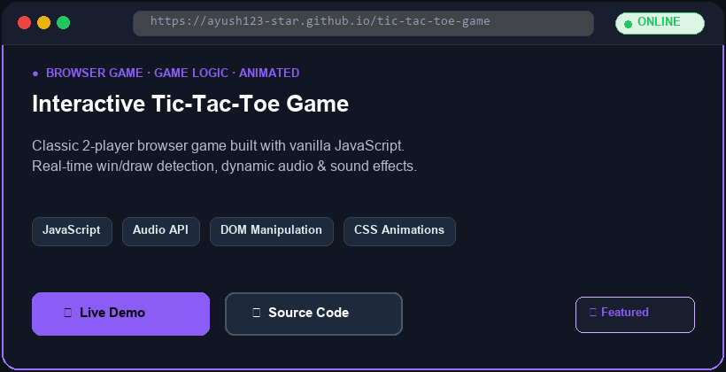
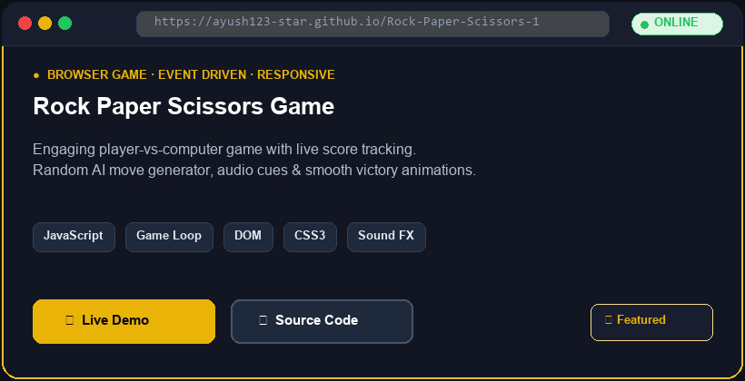

  <!-- ======================== BANNER ======================== -->
  

    

  <!-- ======================== ANIMATED TYPING HEADER ======================== -->
  

  <!-- ======================== PROFILE VIEWS & STATUS BADGES ======================== -->
  

    
    
    
    
  

  

  <!-- ======================== QUICK CONNECT & DIRECT PROFILES ======================== -->
  <h2>
    ⚡
    Connect With Me
    ⚡
  </h2>
  
<i>Tap any card below to directly open my live profiles:</i>

  

    
    
    
    
    
  

  

    
    
    
    
    
    
  

 

<!-- ======================== ABOUT ME ======================== -->
## ✦ About Me

> 🎓 **Engineering Student & Full-Stack Developer**  
> Pursuing **B.Tech in Electronics & Telecommunication (2025–2029)** at **Madhav Institute of Technology and Science (MITS), Gwalior**.

- 🚀 **Full-Stack Web Engineering:** Architecting scalable, responsive web applications using modern JavaScript, Node.js, Express, and Socket.IO.
- ⚡ **Real-Time Communication:** Specialized in persistent bidirectional event messaging, live dashboards, and low-latency client-server workflows.
- 🎯 **DSA & Algorithmic Problem Solving:** Actively solving challenges on **LeetCode** and participating in coding contests with a focus on optimal time & space complexity.
- 🏛️ **Campus Leadership:** Technical Team Member at **IEEE MTT-S Student Branch Chapter, MITS-DU**.
- 🎸 **Passions Beyond Coding:** Playing acoustic guitar, capturing moments through photography, and exploring Japanese culture and language.
- 📫 **Direct Contact:** [pandeyayush1603@gmail.com](mailto:pandeyayush1603@gmail.com) • [+91 90395 67623](tel:+919039567623)

  
  
  
  

 

<!-- ======================== TECH STACK & SKILLS ======================== -->
## ✦ Tech Stack & Tools

  

 

| Domain | Technologies, Frameworks & Tools |
| :--- | :--- |
| <b>Frontend Development</b> |      |
| <b>Backend & Real-Time</b> |     |
| <b>Languages & DSA</b> |     |
| <b>Databases & Storage</b> |   |
| <b>DevOps & Deployment</b> |      |
| <b>Analytics & Design</b> |     |

 

<!-- ======================== FEATURED PROJECTS SHOWCASE WITH PHOTOS ======================== -->
## ✦ Featured Projects Showcase

*Every project uploaded on GitHub presented with interactive photo cards, tech stacks, live demos, and source codes:*

  <!-- PROJECT 1 -->
  
  

    <b>💬 Real-Time Chat Application</b> — Instant bidirectional chat app with live user join alerts & zero page reloads. 
    
    
  

   

  <!-- PROJECT 2 -->
  
  

    <b>🍔 MITS Canteen Management</b> — Digital ordering and cafeteria management platform built specifically for MITS campus. 
    
    
  

   

  <!-- PROJECT 3 -->
  
  

    <b>🌦️ Real-Time Weather Dashboard</b> — Global weather tracker querying Open-Meteo REST API for live temperature, wind & pressure. 
    
    
  

   

  <!-- PROJECT 4 -->
  
  

    <b>💱 Real-Time Currency Converter</b> — Live exchange rate converter with automatic country flag changes & quick swap mechanics. 
    
    
  

   

  <!-- PROJECT 5 -->
  
  

    <b>🎨 Advanced CSS3 Architecture</b> — Pixel-perfect modern showcase featuring 2D CSS Grid, Flexbox, custom tokens & fluid typography. 
    
    
  

   

  <!-- PROJECT 6 -->
  
  

    <b>⚡ IEEE MTT-S Workshop Registration</b> — Accessible event portal with track selection, drag-and-drop resume upload & RegEx validation. 
    
    
  

   

  <!-- PROJECT 7 -->
  
  

    <b>🎮 Interactive Tic-Tac-Toe Game</b> — Classic 2-player browser game with win/draw detection, game reset & dynamic audio effects. 
    
    
  

   

  <!-- PROJECT 8 -->
  
  

    <b>✂️ Rock Paper Scissors Game</b> — Player-vs-computer game with live score tracking, random AI move logic & sound effects. 
    
    
  

 

  

 

<!-- ======================== GITHUB STATS & STREAK & LEETCODE ======================== -->
## ✦ Activity, GitHub Stats & LeetCode Performance

  

    
    
  

  

    
    
  

   

  <!-- LEETCODE CARD -->
  <h3>
    ⚡
    LeetCode DSA Problem Solving Stats
    ⚡
  </h3>
  

 

<!-- ======================== SNAKE ANIMATION ======================== -->
## ✦ Contribution Snake Animation

  <picture>
    <source media="(prefers-color-scheme: dark)" srcset="https://raw.githubusercontent.com/ayush123-star/ayush123-star/output/github-contribution-grid-snake-dark.svg">
    <source media="(prefers-color-scheme: light)" srcset="https://raw.githubusercontent.com/ayush123-star/ayush123-star/output/github-contribution-grid-snake.svg">
    
  </picture>

 

<!-- ======================== CERTIFICATIONS & HACKATHONS ======================== -->
## ✦ Certifications & Hackathons

- 🏅 **Automate India Hackathon 2026** – Powered by HackBriven at Microsoft Office, Noida
- 🌟 **Google Student Ambassador Program 2026** – Fund My Crazy: Build Night Edition
- 💻 **GFG - Code Rush** – Competitive Programming & Algorithmic Problem Solving
- 🎯 **No Code Knockout** – IETE Students' Forum, MITS-DU
- 📊 **MS Power Bootcamp & Power BI** – Department of ETE & IETE Bhopal Center
- ⚡ **Renewable Energy at URJA 2026** – Electrical Engineering Department
- 📜 **Web Development Internship Certificate & LOR** – Thiranex
- 🎖️ **Internship Common Aptitude Test (ICAT)**

 

<!-- ======================== CONTACT ME FOOTER ======================== -->
## ✦ Let's Connect & Talk

  
    I am actively looking for internship, fellowship, and collaborative development opportunities. 
    <b>Whether you have a project idea, question, or just want to say hi — my inbox is always open!</b>
  

  
  
  
  

    

  

    <i>"Talk is cheap. Show me the code." — Linus Torvalds</i>
  

  

    Designed with ❤️ by <b>Ayush Pandey</b> • © 2026 All Rights Reserved
  

  <!-- Waving Gradient Footer Effect -->
  

